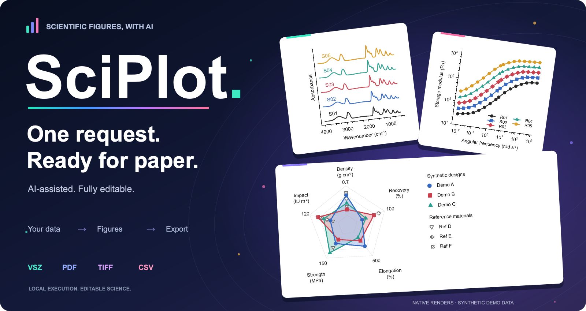
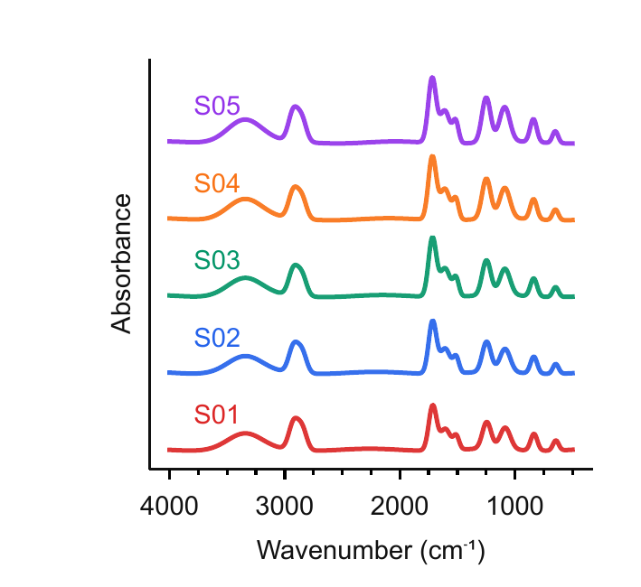
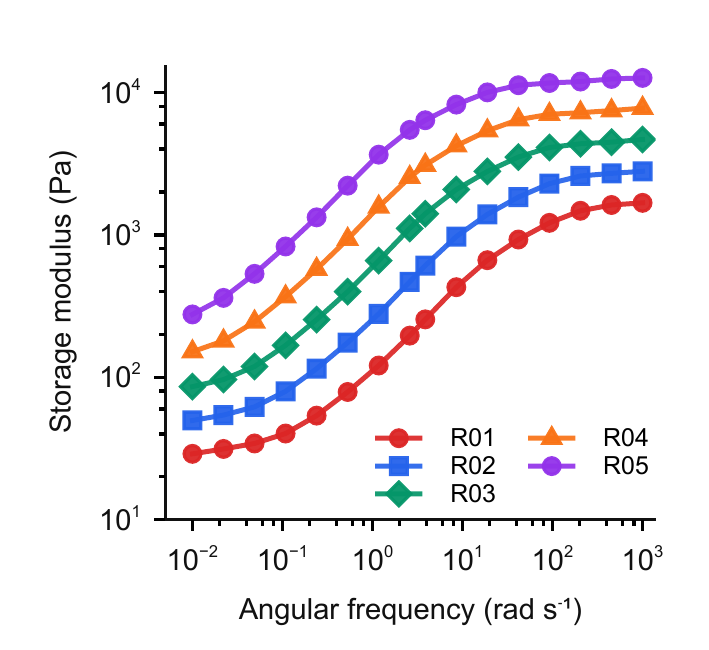
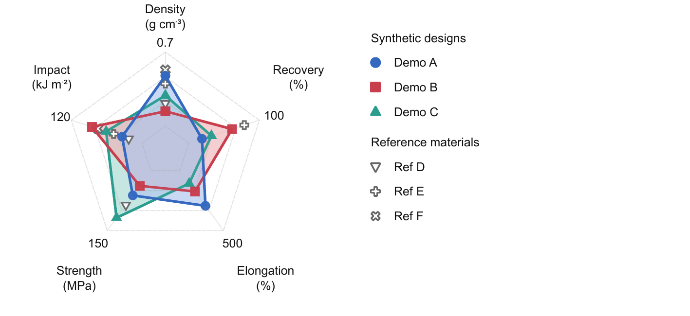
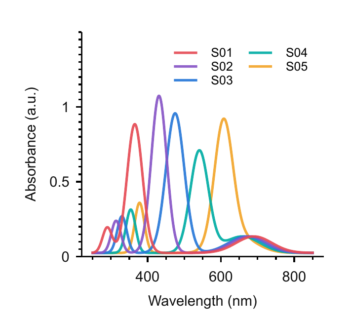
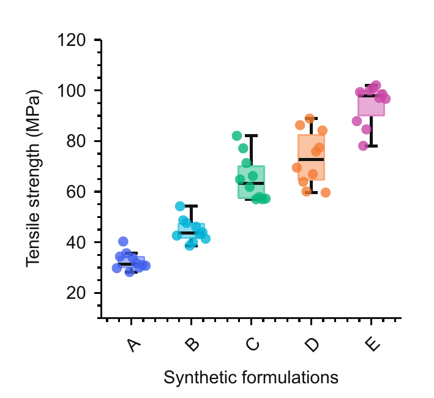
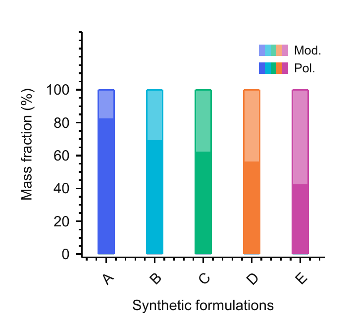
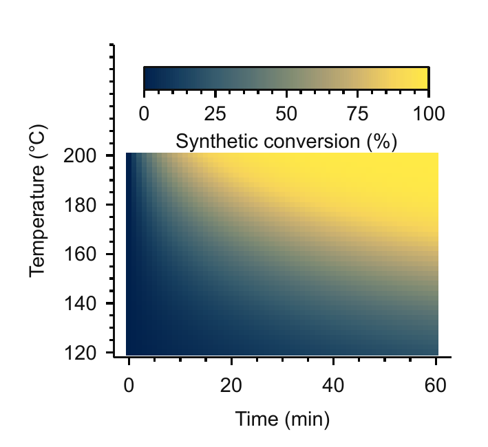
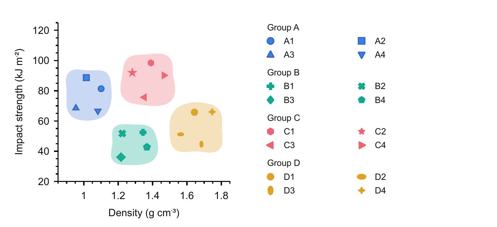

# SciPlot

### Publication-ready figures. One request away.

**AI 辅助，一键出图。让实验数据直接成为可编辑的论文图稿。**

Ask your AI assistant for the figure you need. SciPlot turns experimental data into **vector PDF,
300 dpi TIFF, plotting CSVs, and an editable project** in one workflow.
Bring the result into your manuscript, then keep refining it as your research evolves.

[**Download source ↓**](https://github.com/tunghsutian-creator/Science-Plot/archive/refs/heads/main.zip) · [Get started](#get-started) · [See the figures](#gallery) · [Connect your AI](#connect-your-ai)



## From experiment to manuscript

- **Ask for the figure, in your own words.** Your AI assistant interprets the request;
  SciPlot handles data preparation, plotting, checks, and export locally.
- **Start with publication-sized output.** Consistent typography, physical dimensions,
  and vector graphics help your figures fit together across a paper.
- **Keep control after export.** Reopen the editable figure, adjust its appearance,
  and regenerate the files. Your original data stays intact.

For example, tell your AI assistant:

> Use SciPlot to plot the five samples in `/path/to/spectra.csv`.
> Keep the original sample names and units. Make a 60 × 55 mm figure
> and export PDF, TIFF, and the editable project for my paper.

**Give it your data → describe the figure → review the result.**
Once the data and intent are clear, one local task carries the figure through to
export. If samples, units, or worksheet choices are ambiguous, SciPlot asks for
clarification before proceeding.

A task can also accept several attachments and a small explicit coordinate
intent, including a secondary axis. The program reads the source tables and
expands their current facts into the existing Managed figure contract. It returns
one source-bound plan for unresolved scientific choices, such as temperature
column roles or how reset-time stages join. When worksheets are ambiguous, the
task first asks which original tables to use, then asks only the remaining
questions for those tables. Explicit secondary-temperature selectors bind the
actual original column; conflicting selectors stop before plotting.
Experiment identity does not depend
on which coordinate is selected for a particular view.

Mixed instrument tables can select exact observed Test values or qualified source
blocks in that same task. The source plan retains selected and excluded original
rows, counts and reasons, while the original file and its hash remain intact.
Selection happens before scientific coordinate derivation and unit conversion.

With no experiment rule, confirmed numeric coordinates and original units can
create an ordinary XY figure without inferring an experiment from its axes.
Acquisition context remains a user statement in provenance; signed values,
gaps, duplicate coordinates and original order remain intact. For original
Impact replicate tables, `box`/`box_strip` with `--summary-statistic raw_only`
draws the original points without calculating or adding summary statistics.
Explicit linear/log choices validate the complete mapped coordinate. Original
storage/loss-modulus curves can share one compatible Y axis while retaining
each pair's own X grid. Wide replicate bars can deliver audited mean, sample
SD and valid n in a visible source-bound summary CSV after an explicit missing
value policy. For tidy performance tables, the
[Metric selection route](skill/references/performance-selection.md) binds two
original Metrics and any missing per-Metric units; original X positions can be
preserved without display jitter.
Original [categorical tables](skill/references/ordinary-categorical.md) can bind
sample, condition and value columns without selecting an experiment. Supplied
results use point-lines without invented errors; declared replicate groups use
the existing mean/sample-SD bars. Subsets, category order and display names are
explicit, and source bytes and physical cell identities remain intact.
Saved ordinary categorical figures also expose
[later display edits](skill/references/categorical-presentation-edit.md): category
aliases, bar colors, given-value marker styles and represented native-key layout.
Current source selectors and expected values bind the existing edit transaction;
original observations, statistics and scientific identities remain unchanged.

New registered `xrd_pattern`/`curve` figures use a qualitative peak-pattern default:
with linear Y and no normalization by the recipe, hide Y numbers and major/minor
ticks while retaining the axis title, axis line and X ticks. This is not inferred
from `a.u.` labels or values in 0–1. A `render_options.show_y_ticks` boolean
recorded in the canonical plot request takes priority; without it, explicit Y
limits, manual ticks or log scale retain the readout. UV–vis absorbance, SAXS log
plots and generic Managed XY get no new hiding default. Saved VSZ figures are
not rewritten.

Confirmed phase concatenation records original row lineage and its boundary
policy. Unit conversion records both units and the exact conversion. Optional
PCHIP interpolation creates a separate display curve through the measured knots;
all measured points remain available in the native document and marker binding.
It does not smooth away noise or add measurements. Reference images guide
presentation and cannot supply missing numerical values or elapsed time.

Correct an uncommitted intent in the same task. Once an attempt commits, its
scientific request stays immutable; retry continues its export and a revised
intent creates another bound attempt. Receipts distinguish semantic commit,
native audit, rendering and completed delivery. Failed native attempts retain
their command, exit code and streams in separate local diagnostic files.

For an understood group of figures, include the requested presentation batch in
each `task group start` create item. One group response returns all bound
candidates and the acceptance template; review them together and continue with
`task group resume`. Later changes remain separate intents and previews. The
group checks original source bytes before applying a saved continuation.
After the selected items finish, `task paper start --group GROUP --out NEW_OUTPUT
--paper-dir NEW_CHECKPOINT --json` captures their current versions in order and
copies sealed PDF/TIFF publications into one portable editable package. Its first
successful response reports checked package/source currentness. Missing or
changed publication evidence blocks delivery and points back to the original
export; packaging does not redraw the figures. See the
[create route](skill/references/ordinary-create.md) and
[paper route](skill/references/paper-figures.md).

Saved ordinary figures also support a persistent semantic editing engine. For a
previously identified ManagedPlot, start with `sciplot plot open TARGET --scope
summary --json`; it returns currentness, revision and stable edit targets without
the full template/schema payload. Request the chosen target/property's current
value, exact schema and risk with `plot describe --scope edit --target-id ID
--property NAME`, then send `plot.patch` with the returned plot ID and revision.
For an exact FigureSpec v2 axis label or annotation text, `plot.intent` can plan
the literal edit and then apply it through that same patch transaction. A safe width/color/title
visibility edit validates, commits and exports in one transaction; the program
owns native paths and recovery. Repeating its idempotency key resumes the same
work. Structural changes return a bound preview when needed. CLI and MCP share
this engine; existing projects retain their native VSZ and explicit partial-import
coverage. See the [saved-figure route](skill/references/saved-figure-edit.md).
`task style` selects represented series by stable ID or a unique source/display
label. For ordinary FigureSpec v2 measurement line/point layers, color updates
both line and point symbols; width updates line marks only. Existing line
patterns, marker geometry, opacity and unrelated explicit styles remain intact.
Point-only layers accept color, while line width requires an actual line mark.
Ambiguous selections and unsupported v2 mark families reject before saving a
style request. Existing
v1/Legacy properties and their review requirements remain in force; v2 uses its
advertised generic style risk and color schema.
Represented curves support display names and hide/show edits while retaining
their complete source data. In figures with auto/fixed endpoint rules, automatic
axis endpoints follow visible curves while explicit limits remain fixed. Showing
a retained curve restores its contribution to the automatic window; manual ticks are never
silently dropped. Older saved numeric windows retain their original behavior.
Legend contracts expose column count and complete
member order, retaining hidden members for later restoration. Managed line styles
use the existing native pattern catalog, including `dash-dot`; saved `dash` and
`dot` spellings still replay. Export checks the requested layout. An
original-value Managed XY view can
[append a new original table](skill/references/source-append.md) through a
scientific preview in the same plot. The program reads its columns and validates
quantities, units and scale domains before acceptance; existing styles and axes
stay bound to that plot.
An unused response pair or an exactly identified independent Test block from
the same unchanged original file can be appended through that contract. The
literal Test name remains the scientific sample; display aliases are separate.
Registered numeric unit conversions require explicit target units matching the
current axes. An already bound response and overlapping rows cannot be duplicated
by changing its label or visibility.
After an uncertain reply, retain the original plot ID, base revision and
idempotency key. `plot describe` exposes the frozen pending receipt and its next
step; `plot resume` loads that exact saved request under the existing source,
native and revision guards. A pending preview still requires its bound decision,
and a committed edit can continue export without applying it again. CLI, RPC and
MCP share the same recovery owner.
When authority is unknown or the figure is a LegacyPlot, omit the scope for the
unchanged full open. Reuse that response; legacy imports retain their full open
behavior and native coverage, with no automatic conversion to ManagedPlot.
The managed summary also includes `rebuild_explanation`: observed changed input
reasons, affected descendants from the saved dependency graph, and nodes not
marked invalid by those observations (first 32 IDs plus the total count). That
last list is not a verified future cache hit; `verified_reused_nodes` stays empty
until execution validates reuse.
The summary reads fingerprints and build receipts but does not run scientific
transforms, native inspection, compilation, rendering or export. For a changed
native artifact it defers inspection, retaining the explicit external-mutation
resolution action; the full description retains its existing inspection behavior.
An observed renderer-identity mismatch can be a rebuild trigger even while saved
input status is current and the saved graph marks no node invalid.

The same patch surface covers supported axis limits, legend placement/visibility
and managed annotations. FigureSpec v2 also exposes supported legend locations
and annotation coordinates through the same typed contract. View and figure
coordinates are presentation edits within `[0, 1]`; data coordinates require
scientific intent. Template creation separates the format, theme and explicit
data binding, then produces one final export. A saved native-only change can return
one audited reimport preview; source or mapping changes still require their
scientific workflow. The local service reuses its native worker between operations.

Creation replies include `plot_objects` handles for supported continuation.
Prepared rheology figures use the same describe/patch/decide/resume/export surface
for advertised legend and existing-note edits, retaining saved VSZ authority.
The program reads current native values, checks unchanged scientific evidence and
preserves unrelated native settings. Each selected figure can be edited and
exported independently of optional suite figures; a presentation delta does not
resubmit numerical arrays or repeat the scientific analysis. Inspect the returned
capabilities before choosing an operation. Native revisions are content-bound
identities, while Managed revisions retain their existing revision sequence.

For a common presentation change, use one bounded local entry:

```bash
sciplot task edit TARGET --intent '换配色 tol_bright；统一字号 9pt；图例字号 7pt' --task-dir STABLE_EDIT_DIRECTORY --json
```

The clauses and palette names are exact. Font family and legend controls depend
on the saved figure's advertised authority; unsupported changes are rejected
before applying any part of the request. Keep `--task-dir` stable from the first
call to recover an uncertain reply. A pending preview still needs its returned
revision-bound continuation. Raw values and scientific hashes remain unchanged.
For saved ordinary figures, export checks legend clearance against current
native geometry. Generation-time diagnostics remain available as history;
stale or unsupported native measurements cannot establish a current pass.
See [common saved edits](skill/references/saved-figure-edit.md).

If a source or project moved, `task continue SOURCE --search-root KNOWN_FOLDER
--json` finds exact source matches in a bounded folder search. Identical copies
remain separate choices; select the returned exact `--target`. It checks the
current editing authority without rebinding sources or modifying old receipts.
Export snapshots remain explicitly distinct from their original project.
See [find and continue](skill/references/saved-work-continuation.md).

For a manuscript, [selected paper figures](skill/references/paper-figures.md)
packages one explicitly selected figure per item across saved projects, in the
requested order, with PDF, TIFF, portable editable VSZ and source-version
evidence. Originals stay unchanged. Existing output directories, changed sources
and changed package contents block publication or reuse; an exact retry resumes
unfinished work. Historical completion alone does not certify a current package.

For current ManagedPlots, [Managed delivery](skill/references/managed-delivery.md)
uses `plot deliver` (RPC `plot.deliver`, MCP `sciplot_plot_deliver`) to package
an ordered selection of byte-sealed publications. It creates the index, original
data, exact plotted datasets, PDF/TIFF, native snapshots, launcher and ZIP locally.
Each item retains its own revision and recovery state. Missing or changed export
evidence blocks packaging without rebuilding or replacing the original figure.
A package can reconnect to an unchanged original ManagedPlot on this Mac; its
independent VSZ remains editable after relocation. The package does not contain
a portable Managed document registry or a standalone human Managed editor.

A local panel workbench brings saved figures and microscopy images or diagrams
onto one physical page. Run `sciplot compose open` to select figures across
projects, drag whole panels, set grid spans and millimetre gaps, edit panel
letters, crop images, and undo or redo changes. Save the layout to reopen it.
Supported scientific panels reflow through native Veusz at the target size;
PDF text and scientific graphics retain physical size. Export produces a vector
PDF, TIFF and editable layout/native sources. Source drift, unsupported native
geometry and actual text clipping block export with a reason. Preview images
show selected sources and do not certify target-size export readiness.
AI clients can send one short typed layout batch through CLI or MCP;
subsequent local dragging and spacing need no AI calls. See the
[panel assembly route](skill/references/panel-assembly.md) for commands and limits.

[Performance radar figures](skill/references/performance-radar.md) now show units,
raw axis ranges, improvement direction and the declared normalization formulas.
Radius is dimensionless, and polygon area is not an overall score. The fixed
60 × 55 mm scientific plot panel keeps its coordinates; a new one-column radar
uses a 120 × 55 mm page with a reserved interpretation panel. Conflicting explicit
page dimensions are rejected. Existing saved VSZs retain their visual authority.

Template-based `plot.create` now creates a **ManagedPlot** by default for the
supported Cartesian and FigureSpec v2 contracts. Its SciPlotDocument is authoritative:
resolved PlotIR compiles into disposable VSZ, previews and PDF/TIFF. Keeping raw
sources and `.sciplot_documents` is sufficient to rebuild deleted artifacts with
`plot export`. Source/transform/executor updates require explicit scientific
intent; theme edits preserve scientific identity. Fixed-file external scientific
executors carry interpreter/script hashes and provenance. Unknown manual Veusz
changes block rather than enter the canonical document.

You can create, edit and export through the AI assistant and the SciPlot canvas
without opening a VSZ file yourself. SciPlot still uses Veusz internally:
ManagedPlot compiles its authoritative document into VSZ for native rendering,
while a LegacyPlot keeps its saved VSZ as the complete visual baseline. VSZ is
therefore still part of the current project and editable delivery; a rebuildable
Managed artifact does not mean the rendering backend has been removed.

New Managed native builds are saved in an owned staging directory, audited and
previewed before the complete VSZ is published without replacing an existing
file. An interrupted save can leave diagnostic staging files; retry never
adopts an unknown partial native file as a successful build.

Existing VSZ imports, source-only task creation and explicit `mode: legacy` remain
**LegacyPlot** compatibility workflows. FigureSpec v2 adds physical single/concat/grid
composition, independent scientific Scales and visual Axes, seven generic Marks,
scoped themes, semantic legends and data/view/figure annotations. Dual Y and
multipanel scientific figures use this common grammar. Native text bounds and
scientific mapping checks gate export; soft layout warnings remain explicit.
Arbitrary native features and non-deterministic execution remain unsupported.
New FigureTemplate documents pin the extracted `sciplot-house-style-v1` visual
contract. Omitted layout uses the original 60 × 55 mm panel and fixed physical
margins. New semantic tasks select a versioned presentation policy that reserves
additional space for decorated right/top axes before native compilation. Older
saved figures retain their layout interpretation. The resolved layout records
the selected policy. Single-axis defaults and
theme/figure/view/layer/mark overrides stay explicit. Existing unbound
Managed revisions and fully explicit Cartesian v1 templates retain their saved
presentation. Old-versus-new visual regression is independent of rebuild QA.
See [rendering contract](docs/DESIGN_RENDERING_CONTRACT.md),
[Figure grammar, schemas and capabilities](docs/DESIGN_FIGURE_GRAMMAR.md) and
[managed authority guarantees](docs/DESIGN_MANAGED_PLOTS.md).

Real historical mechanical and PP frequency-sweep deliveries now have independent
golden-master profiles: frozen accepted artifacts, fresh legacy production replay,
and ManagedPlot must pass native structure, data, environment and raster checks.
See [research compatibility profiles and evidence](docs/RESEARCH_COMPATIBILITY_PROFILES.md)
for exact coverage, the bounded mechanical antialias difference, and unsupported cases.

Ordinary raw-data entry without an explicit semantic coordinate intent
(`task create`, source-only `plot.create`, and their MCP routes) keeps the
existing production workflow: scientific recognition, the
family's FigurePlan and templates, then shared house policy plus family rules and
supported explicit overrides. `render --auto` uses that same workflow; plain
`render --template` remains a low-level plot-ready operation. FigureTemplate v2
supports both explicit low-level composition and the local task adapter for a
semantic coordinate intent. It is not the automatic source-only default.
Its RenderingStyleContract is extracted from production policy; unverified
family compatibility is not a reason to silently switch ordinary plots to it.

Frequency instrument exports preserve explicitly labelled temperature Results as
separate traces. Complex-viscosity magnitude is distinct from a recorded real or
imaginary component. With original G′, G″, frequency and compatible unit evidence,
SciPlot can derive the missing magnitude through its recorded deterministic
transform. The [ordinary creation guide](skill/references/ordinary-create.md)
shows the small public coordinate intent; original measurements stay unchanged.
The same semantic attachment route retains quantity/sample/unit rows and each
explicit sample's independent numeric grid, including unshifted spectral
overlays from one multi-sample CSV. Closed machine-header spellings
such as `temperature_C` and `heat_flow_W_g` supply explicit units. Unknown fields
need exact original selectors; missing units need a separate `source_unit`
declaration in the small intent, retained as user evidence. `unit` remains the
requested output unit and never silently supplies a missing source unit.
An explicit coordinate `direction` reuses the existing ascending/descending
display scale; it never reverses, sorts or shifts the source arrays.

## Gallery

These figures were rendered by **SciPlot / Veusz** from synthetic demonstration
data. Standard figures use **60 × 55 mm**; performance comparisons use
**120 × 55 mm**. Click an image for the full-size view.

<table>
  <tr>
    <td width="50%" valign="top">
      <b>Spectral fingerprints, clearly separated</b><br>
      <a href="docs/assets/showcase/v2/curves/stacked-spectra.png"></a><br>
      Compare five spectra with direct labels and consistent sample colors.
      Curves are offset for display; source values are preserved.
    </td>
    <td width="50%" valign="top">
      <b>Rheology, across five decades</b><br>
      <a href="docs/assets/showcase/v2/curves/rheology-point-lines.png"></a><br>
      Distinct markers and a shared color palette make five rheology curves easy to follow.
    </td>
  </tr>
  <tr>
    <td colspan="2" valign="top">
      <b>Five properties. One comparison.</b><br>
      <a href="docs/assets/showcase/v2/performance/performance-radar-rich.png"></a><br>
      Compare the balance of properties across samples. Reference materials retain only
      their available measurements; polygon area is not an overall performance score.
    </td>
  </tr>
</table>

<details>
<summary><b>More examples: absorption spectra, distributions, composition, response maps, and scatter comparisons</b></summary>

<table>
  <tr>
    <td width="50%" valign="top">
      <b>Absorption spectra</b><br>
      <a href="docs/assets/showcase/v2/spectra/spectra-rich.png"></a><br>
      Bring multiple samples into one consistent figure.
    </td>
    <td width="50%" valign="top">
      <b>Replicate distributions</b><br>
      <a href="docs/assets/showcase/v2/distributions/replicate-distributions.png"></a><br>
      Show the distribution and the individual observations together.
    </td>
  </tr>
  <tr>
    <td width="50%" valign="top">
      <b>Composition</b><br>
      <a href="docs/assets/showcase/v2/distributions/composition-bars.png"></a><br>
      Compare the composition of five formulations at a glance.
    </td>
    <td width="50%" valign="top">
      <b>Response maps</b><br>
      <a href="docs/assets/showcase/v2/distributions/response-heatmap.png"></a><br>
      Make trends across two variables easy to read.
    </td>
  </tr>
  <tr>
    <td colspan="2">
      <b>Performance comparison</b><br>
      <a href="docs/assets/showcase/v2/performance/performance-scatter-rich.png"></a><br>
      Put your samples in context. Shading shows the sample range, not a confidence interval.
    </td>
  </tr>
</table>

</details>

[Explore the example data and reproduction notes →](docs/assets/showcase/v2/README.md)

SciPlot supports **mechanics, rheology, DSC/TGA, FTIR/UV–vis, XRD/SAXS, GPC/SEC,
torque, swelling, and material performance comparisons**, using supported
instrument exports and CSV, TSV, or Excel tables. Multi-sheet workbooks and
curves with different row ranges can stay in their original files.

## What you get

Each delivery includes the figure and the files needed to revisit it:

| Output | Ready for |
| --- | --- |
| **Vector PDF** | Manuscripts, presentations, and crisp scaling |
| **300 dpi TIFF** | Submission workflows that require raster figures |
| **Editable VSZ** | Native source for SciPlot and optional advanced Veusz editing, with plotting data embedded |
| **Plotting CSVs** | Inspecting and reusing the source-derived data behind the figure |

Outputs are saved beside your source data in `SOURCE_SciPlot/` by default.
Original files, sample identities, units, and data provenance are preserved.
Missing reference values stay missing.

Normalized stress-relaxation wide tables with explicit `t_s` and
`sigma_over_sigma0` pairs use the ordinary task route, including independent
curve lengths and source-bound column choices. `task create --xscale linear`
retains zero-time observations; `--xscale log` records the explicit positive-time
selection. Neither choice normalizes an already-normalized ratio again. Use
`--choose-columns` when the sample subset needs confirmation. Existing export
QA still applies; style and legend constraints use the saved-figure edit route.
See [ordinary creation](skill/references/ordinary-create.md).

Physical-size and export checks are part of the workflow. Match the final
dimensions, resolution, and styling to your target journal's requirements.

## Your figure stays editable

Keep working with the same AI assistant:

> Make the E0 and E3 curves thicker and show me a preview.

> Reuse these sample colors in my FTIR figure, matching by sample name.

> Show me three style alternatives for this figure so I can choose one.

For direct adjustments, double-click **`Open_in_SciPlot.command`** in the delivery
folder. Select a curve or sample, adjust its supported visual properties, and see
the figure redraw. Native undo and redo let you explore changes.

- **Save** updates the editable project.
- **Save and update delivery** also refreshes the delivered VSZ, PDF, and TIFF
  through the existing checks.

The canvas resumes the original managed project. For advanced native editing,
use `Open_in_Veusz.command`. A copied delivery can open its portable Veusz file;
editing that copy does not update the original project. See the
[editing and continuation guide](skill/references/advanced-workflows.md) for
source updates, moved deliveries, and separately edited files.

## Get started

**[Download the source ZIP](https://github.com/tunghsutian-creator/Science-Plot/archive/refs/heads/main.zip)**
or clone the repository below. The current download is source code; a signed
macOS installer has not been published yet.

Source installation requires **Python 3.11+**, a **C/C++ compiler**, and
**Qt 6 development tools**, including `qmake`.

The declared numerical dependency window for this source version is
**NumPy 2.4.6–2.4.x** and **pandas 3.0.6–3.1.x**. Upgrading outside that window
requires a compatibility review. These bounds define the compatibility target;
they do not certify every admitted combination. The concrete references used
for these checks are:

| Reference | Python | NumPy / pandas / SciPy | PyQt / loaded Qt |
| --- | --- | --- | --- |
| Local macOS native runtime | 3.14.7 | 2.4.6 / 3.0.6 / 1.18.1 | 6.11.0 / 6.11.2 |
| Ubuntu 24.04 CI | 3.12.3 | 2.4.6 / 3.1.0 / 1.18.1 | 6.6.1 / 6.4.2 |

These references identify installation and compatibility checks; they do not
certify every combination admitted by the Python 3.11+ language floor. CI pins
its numerical, PDF and image package versions to keep those listed versions
fixed during repair; other dependencies and OS packages can still change.
Its SciPy pin applies only to that Python 3.12
job. Package versions alone cannot reproduce system Qt, native helpers or fonts;
Doctor and the corresponding native/data acceptance remain necessary.

```bash
git clone https://github.com/tunghsutian-creator/Science-Plot.git
cd Science-Plot

python3 -m venv .venv
.venv/bin/python -m pip install -e '.[studio,mcp]'
(cd third_party/veusz && ../../.venv/bin/python setup.py build_ext --inplace)
skill/scripts/sciplot doctor --json
```

If you downloaded the ZIP, open a terminal in the extracted folder and start
with the `python3 -m venv .venv` command. Continue when Doctor reports
`status=ready`. If `qmake` is outside your `PATH`, set `QMAKE_EXE` to its location
before building.

The build resolves `sip-build` from the invoked Python environment, so a direct
`.venv/bin/python` invocation does not require activation. Interrupted binding
generation is retried in a new build directory. Doctor requires all five
vendored native helpers to load successfully.

On macOS, the wrapper uses a matching local Qt runtime from
`.local/runtime/qt/lib` when present. `SCIPLOT_BUNDLED_QT_LIB` selects an explicit
library directory instead. Keep the selected Qt frameworks compatible with the
PyQt platform plugins and native helpers. A Homebrew upgrade can change its
`opt` links independently of an existing virtual environment; restore the
matching runtime locally before continuing native work.

Doctor's `execution_identity` reports the loaded source, checkout HEAD when
applicable, Python, Veusz and runtime roots. Its continuation identifies the
command and environment for the next CLI call. Use this when several checkouts
or an installed command coexist. A Git HEAD identifies checkout metadata;
native execution and uncommitted source bytes require their own verification.
Opening another checkout does not migrate existing projects or running sessions.

Source setup has been checked locally on macOS. Windows and Linux installation
are not yet verified; independent installation and beginner acceptance are
tracked in the [acceptance protocol](docs/INDEPENDENT_ACCEPTANCE.md).

### Connect your AI

SciPlot is a local scientific plotting tool for use with an external AI assistant.
It runs plotting and exports locally. SciPlot itself needs no model API key;
your assistant uses its own model connection.

**With a coding assistant:** give it the repository path and ask it to read
[`skill/SKILL.md`](skill/SKILL.md). Then describe your figure and provide the
path to your data, as in the example above.

**With an MCP client:** add a local stdio server using the absolute path to
`skill/scripts/sciplot` as the command and `mcp` as its argument.

<details>
<summary>Example configuration for clients that use <code>mcpServers</code></summary>

Replace the example path with your checkout location:

```json
{
  "mcpServers": {
    "sciplot": {
      "command": "/absolute/path/Science-Plot/skill/scripts/sciplot",
      "args": ["mcp"]
    }
  }
}
```

</details>

The assistant needs access to your local files. See the
[AI connection guide](skill/references/external-control.md) for CLI and MCP details.

## Explore and contribute

- [Example data and figure recipes](docs/assets/showcase/v2/README.md)
- [Advanced workflows: editing, style reuse, comparisons, and source updates](skill/references/advanced-workflows.md)
- [Architecture](docs/ARCHITECTURE.md) · [Development roadmap](DEVELOPMENT_ROADMAP.md)
- [Report a bug or request a feature](https://github.com/tunghsutian-creator/Science-Plot/issues)

For small code changes, run `skill/scripts/sciplot verify --quick` for the complete
related focused checks and static gates. Add `--base main` to include committed
branch changes or `--plan-only` to inspect selection. This is development feedback;
the [development guide](skill/references/development.md) keeps full merge/release
acceptance separate.

If SciPlot helps with your research, **star the repository** to help other
researchers discover it.

Licensed under [GPL-2.0](LICENSE). See [third-party notices](docs/THIRD_PARTY_NOTICES.md).
